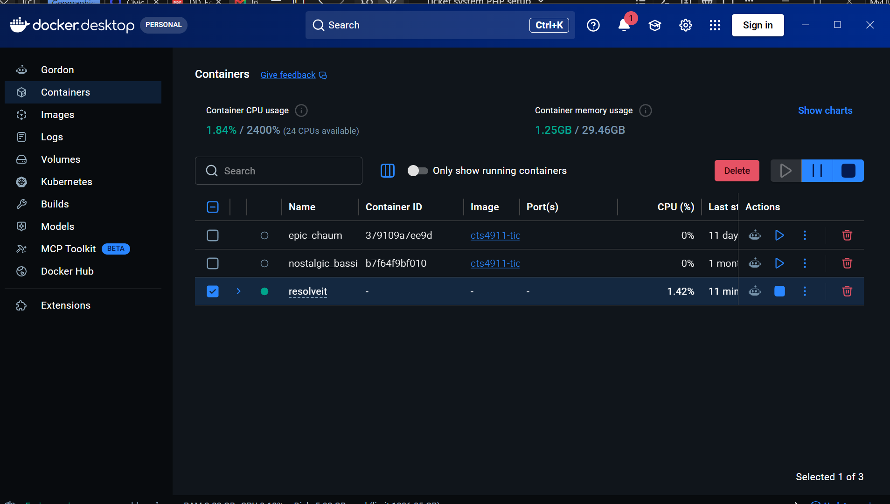
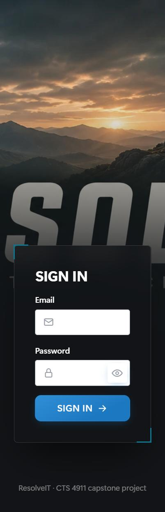

# ResolveIT – IT Ticket Management System (CTS 4911)
## Deployment Guide and Scope Record

| | |
|---|---|
| **Status** | Deployed on Apache (local PC, shared through a Cloudflare tunnel). Scope frozen; see [Scope](#1-scope). |
| **Date** | September 27, 2026 |
| **Version** | Git commit `708b75d` (9 commits since the September 8 baseline) |
| **Owner** | Jordan Black – Requirements, Testing & System Validation |
| **Replaces** | "Complete Deployment Instructions v3.0". That document described files that do not exist (`src/admin/*`, `update_ticket.php`, `db_connect.php`, `admin_check.php`, `demo-dashboard.php`, `docs/*.txt`) and test results that were never run. Do not use it. |

---

## 1. Scope

This section exists to stop scope creep. **The scope is frozen as of September 27, 2026** (CR-06 to CR-11 approved the same day by the project owner). Anything not listed under 1.1 or 1.2 is out of scope until the team approves a change request (1.4).

### 1.1 Baseline scope (the capstone requirements)

| ID | Requirement | Status | Where |
|---|---|---|---|
| P1 | Employees sign in, submit tickets, and see only their own tickets | ✅ Done | `public/ticket-create.php`, `tickets.php`, `ticket.php` |
| P2 | Technicians assign tickets, change priority/status, add notes, record a resolution | ✅ Done | `public/ticket-edit.php` |
| P2-FIX | Status must follow Open → Assigned → In Progress → Resolved → Closed; no skipping steps | ✅ Done, tested | `app/workflow.php` |
| P3-A | Administrators create, edit, deactivate/reactivate users, and reset passwords | ✅ Done, tested | `public/users.php`, `user-edit.php` |
| P3-B | Reporting dashboard | ✅ Done, tested | `public/reports.php`, `app/reports.php` |
| P3-C | System settings (categories, priorities, statuses) and an audit log of admin actions | ✅ Done, tested | `public/settings.php`, `app/audit.php` |
| SEC | Password hashing, prepared statements, CSRF tokens, validation, output escaping, role checks | ✅ Done, tested | `app/auth.php`, `app/bootstrap.php`, `app/validation.php` |

Users are **deactivated, not deleted**, so ticket history stays intact. The old document's "delete users" was never a requirement.

### 1.2 Approved changes after the baseline

Each of these was requested or required after Phases 1–3 were planned. They are finished and **frozen**: no further additions to them without a change request.

| CR | Change | Why | Decision |
|---|---|---|---|
| CR-01 | Deploy on Apache 2.4 instead of PHP's built-in test server | Requested: deployment must be on Apache | Keep |
| CR-02 | Phase 4 advanced analytics: SLA targets per priority, date-range filters, SLA compliance and overdue reports, CSV export | Requested: chosen as the only Phase 4 item | Keep; the other Phase 4 items are deferred (1.3) |
| CR-03 | Sign-in lockout (5 wrong passwords per account or 20 per address in 15 minutes) and Secure session cookies | Required once the site became reachable from the internet | Keep (security necessity, not a feature) |
| CR-04 | Share the Apache site through a Cloudflare quick tunnel | Team needs access; UWF Azure sign-in is blocked by an MFA error and the personal account has no Azure subscription | Keep as interim hosting |
| CR-05 | Azure App Service deployment (`scripts/azure-start.sh`, `app/config.azure.php`) | Always-on server reachable without a PC running | **Deployed (Nov 10)** — live at `resolveit-cts4911.azurewebsites.net`, Basic (B1) plan, Microsoft/UWF sign-in enforced, same Azure SQL database |
| CR-06 | Modern help desk interface: sidebar navigation, top search bar, colour-coded status/priority/SLA badges, phone-friendly layout, and JavaScript enhancements (live SLA countdowns, clickable rows, instant filters, confirmation prompts, character counters) | Requested by the project owner on September 27, 2026 | Keep |
| CR-07 | Dashboard (SLA tiles, my queue, needs-attention list, recent activity) and ticket list search, quick views, filters, sorting, and pagination | Requested on September 27, 2026; moves "search, filters, pagination" out of the deferred list | Keep |
| CR-08 | Requesters and staff can reply on a ticket until it is closed | Requested on September 27, 2026 (a help desk needs two-way updates) | Keep |
| CR-10 | Help desk features modelled on a commercial help desk (Spiceworks): *Waiting on requester* and *Past due* views, staff-set due dates, first-response and close-time tracking, requester departments, knowledge base with search and drafts, bulk assign/priority update, and CSV export of the ticket list (migration 005) | Requested by the project owner on September 27, 2026 | Keep; split-screen view and ads were not copied |
| CR-11 | Sortable column headers; Refresh button and automatic list updates (every 30 s, only when something changed); split-screen view (list plus selected ticket); organizations as real records managed in Settings (replacing CR-10's free-text department, migration 006); Advanced Search page (keywords incl. replies, multi-status/priority, requester, assignee, organization, SLA, waiting, and created/updated/resolved/due date ranges, CSV export) | Requested by the project owner on September 27, 2026; implemented in the project's own code | Keep |
| CR-09 | Bug fix: deactivating a user or resetting their password now signs them out immediately (`users.password_changed_at`, migration 004) | Security defect found during review | Keep |

### 1.3 Out of scope / deferred

These are **not** being built. Listing them here is the decision; raising them again requires a change request.

- Phase 4 remainder: workflow customization UI (adding or reordering statuses). Search/filters/pagination (CR-07) and a phone-friendly layout (CR-06) are now done.
- Native mobile app
- Email notifications and self-service password reset by email
- Custom domain name (the site uses its `azurewebsites.net` address; CR-05 is otherwise live — see 1.2)
- Automatic start of the site at Windows sign-in (moot now that CR-05 is on Azure instead of a local PC)

### 1.4 How to add anything new (change control)

1. Write a one-paragraph change request: what, why, and what it replaces or delays.
2. The team approves or rejects it in writing (a chat message is enough; record the date).
3. If approved, add a row to 1.2 and an automated check to `tests/check-local.ps1` before it counts as done.
4. Anything else goes on the 1.3 list.

---

## 2. What is in the package

```
ticket-system/
├── app/                     PHP logic (not web-accessible)
│   ├── bootstrap.php        Loads config, starts the session, CSRF helpers
│   ├── auth.php             Sign-in, sign-in lockout, role checks
│   ├── workflow.php         P2-FIX status workflow rules
│   ├── reports.php          Report and ticket-list queries (SLA state, due times)
│   ├── ui.php               Badges, SLA countdowns, ticket table, icons, pagination
│   ├── tickets.php          Shared ticket query, sorting, CSV rows, auto-refresh stamp (CR-11)
│   ├── audit.php            Admin audit log helper
│   ├── validation.php       Input validation
│   ├── db.php               SQL Server connection (PDO, Windows Authentication)
│   ├── config.php           Local settings (not in git; copy config.example.php)
│   ├── config.azure.php     Cloud settings from environment variables (CR-05)
│   └── azure-auth.php       Microsoft sign-in for the cloud version (CR-05)
├── public/                  The only folder Apache serves
│   ├── login.php, logout.php, index.php, dashboard.php
│   ├── tickets.php, ticket.php, ticket-create.php, ticket-edit.php
│   ├── users.php, user-edit.php, reports.php, settings.php
│   ├── tickets-bulk.php     Bulk assign / priority (CR-10)
│   ├── search.php           Advanced search (CR-11)
│   ├── kb.php, kb-article.php, kb-edit.php   Knowledge base (CR-10)
│   ├── assets/style.css     Help desk theme (no external fonts or libraries)
│   ├── assets/app.js        Live SLA countdowns and other enhancements
│   └── partials/            Sidebar/top-bar layout
├── database/
│   ├── schema.sql           Full schema for a new database
│   └── migrations/          001 audit log, 002 SLA targets, 003 sign-in attempts, 004 password_changed_at, 005 help desk features, 006 organizations
├── deploy/
│   ├── apache/              Apache site config and one-time setup script
│   ├── tunnel/              Cloudflare tunnel start script (CR-04)
│   └── docker/              Apache container for Azure (CR-05, not deployed)
├── scripts/                 create_user.php, Azure migration/start scripts
├── tests/                   check-local.ps1 (automated), manual-test-cases.md
├── docs/DEPLOYMENT.md       This document
└── start-site.ps1           Starts Apache (or PHP's test server with -Dev)
```

The server components live outside the project, under `C:\Users\draft\AppData\Local\CodexTicketSystem\`:
`php83\` (PHP 8.3.35 + Microsoft SQL Server driver), `Apache24\` (Apache 2.4.68), `cloudflared\` (Cloudflare tunnel).

---

## 3. Pre-deployment checklist

### Environment
- [ ] PHP and the SQL Server driver load:
  ```powershell
  C:\Users\draft\AppData\Local\CodexTicketSystem\php83\php.exe -c runtime\php.ini -r "echo extension_loaded('pdo_sqlsrv') ? 'OK' : 'MISSING';"
  ```
- [ ] Apache configuration is valid:
  ```powershell
  C:\Users\draft\AppData\Local\CodexTicketSystem\Apache24\bin\httpd.exe -t
  ```
- [ ] SQL Server `WORKSTATION\JLB282` is running (service `MSSQL$JLB282`).

### Database
Run in SSMS against `TicketManagement`:
```sql
SELECT 'Tables' AS item, COUNT(*) AS count FROM sys.tables WHERE name <> 'sysdiagrams'
UNION ALL SELECT 'Foreign keys', COUNT(*) FROM sys.foreign_keys
UNION ALL SELECT 'Statuses', COUNT(*) FROM statuses
UNION ALL SELECT 'Priorities', COUNT(*) FROM priorities
UNION ALL SELECT 'Active categories', COUNT(*) FROM categories WHERE active = 1
UNION ALL SELECT 'Active administrators', COUNT(*) FROM users u JOIN roles r ON r.id = u.role_id WHERE r.name = 'administrator' AND u.active = 1;
```

| Item | Expected |
|---|---|
| Tables | 12 (`roles, organizations, users, categories, priorities, statuses, tickets, ticket_notes, ticket_history, admin_audit_log, login_attempts, kb_articles`) |
| Foreign keys | 14 |
| Statuses | 5 (sort order 1–5) |
| Priorities | 4, each with an SLA target |
| Active categories | 1 or more |
| Active administrators | 1 or more |

A database created from an older `schema.sql` needs the migrations, in order (each is safe to run twice):
```powershell
sqlcmd -S "WORKSTATION\JLB282" -E -C -i database\migrations\001_admin_audit_log.sql
sqlcmd -S "WORKSTATION\JLB282" -E -C -i database\migrations\002_priority_sla.sql
sqlcmd -S "WORKSTATION\JLB282" -E -C -i database\migrations\003_login_attempts.sql
sqlcmd -S "WORKSTATION\JLB282" -E -C -i database\migrations\004_password_changed_at.sql
sqlcmd -S "WORKSTATION\JLB282" -E -C -i database\migrations\005_help_desk_features.sql
sqlcmd -S "WORKSTATION\JLB282" -E -C -i database\migrations\006_organizations.sql
```

### Configuration
- [ ] `app/config.php` exists and points at `WORKSTATION\JLB282` / `TicketManagement` (copy from `app/config.example.php` on a new machine). There is no `db_connect.php`.
- [ ] `deploy/apache/cts4911.conf`: the two paths at the top match this machine.

### Security
- [ ] Apache serves only `public/`; `app/`, `database/`, and `LOCAL_LOGIN.txt` are unreachable.
- [ ] PHP errors are logged, not shown (`display_errors off` in `cts4911.conf`).
- [ ] Visitors use the HTTPS tunnel link; the session cookie is Secure and HttpOnly.
- [ ] `LOCAL_LOGIN.txt` (admin password) is deleted or kept private; it is excluded from git.

---

## 4. Deploy

1. **Start the site on Apache**
   ```powershell
   powershell -ExecutionPolicy Bypass -File start-site.ps1
   ```
   Open `http://127.0.0.1:8080` on this PC to confirm the sign-in page loads.

2. **Share it with the team** (second PowerShell window)
   ```powershell
   powershell -ExecutionPolicy Bypass -File deploy\tunnel\start-tunnel.ps1
   ```
   Copy the `https://<words>.trycloudflare.com` link it prints and **paste** it to the team. Do not retype it: look-alike addresses (for example `trycloudfare`) lead to ad sites.

3. **Create team accounts**: sign in as the administrator, open **Manage Users**, and create an account for each teammate with the right role (employee, technician, or administrator). Give each person their temporary password privately; they can have it changed from **Edit** later.

**Limits of this deployment (CR-04):** the link works only while this PC is on and both windows are open, and it changes every time the tunnel restarts. Both stop when the windows close.

---

## 5. Verify

### 5.1 Automated (run with the site up; about 1 minute)
```powershell
.\tests\check-local.ps1 -AdminPassword '<admin password>'
```
Expected: `All checks passed` (137 checks as of September 27, 2026). The script creates temporary QA accounts and tickets and deletes them when it finishes.

### 5.2 Manual acceptance tests

**Test 1 – Admin creates a user (P3-A)**
1. Sign in as administrator → **Manage Users**.
2. Fill in the **Create user** form: name, email, temporary password (12+ characters), role **Technician** → **Create User**.
3. ✅ The user appears in the list. **Settings → Audit Log** shows "user created".

**Test 2 – Workflow enforcement (P2-FIX)** – *if this fails, stop the deployment*
1. As an employee, create a ticket. It starts **Open**.
2. As a technician, open the ticket → **Manage Ticket**. The Status list offers only **Open (current)** and **Assigned**.
3. Try to force Open → Closed (for example by editing the form). ✅ Rejected with "Status cannot move from Open to Closed…".
4. Move it step by step: Assigned → In Progress → Resolved (a resolution of 10+ characters is required) → Closed. ✅ Each step works.
5. ✅ A Resolved ticket can be reopened to In Progress; a Closed ticket cannot change status.

**Test 3 – Reports (P3-B, CR-02)**
1. As administrator open **Reports**.
2. ✅ Eight reports appear, each with a **CSV** link; the date range and presets change the numbers.
3. ✅ **Export all tickets in range (CSV)** downloads a file that opens in Excel.

**Test 4 – Settings (P3-C)**
1. **Settings → Categories**: add a category. ✅ It appears on the New Ticket form; deactivating it hides it again.
2. **Priorities**: change an SLA target. ✅ Saved, and logged in **Audit Log**.
3. **Statuses**: ✅ shows the locked workflow and the allowed next step for each status.

**Test 5 – Dashboard, search, and SLA (CR-06, CR-07, CR-08)**
1. As a technician open **Dashboard**. ✅ Tiles show open, unassigned, overdue, due in 4 hours, my queue, and resolved today; clicking a tile opens the matching ticket list.
2. On **Tickets**, type part of a title in the search box, then try the **Overdue** and **Unassigned** chips and the Status/Priority filters. ✅ The list narrows and the count updates.
3. ✅ The SLA column counts down (for example "3h 12m left"), turns amber when under a quarter of the target remains, and red when overdue.
4. Open a ticket as its requester and post a reply. ✅ It appears under **Conversation**; staff replies carry an "IT Staff" tag.

**Test 6 – Help desk features (CR-10)**
1. As a technician reply on a ticket. ✅ It appears under **Waiting on requester**; when the requester replies it leaves that view. The ticket shows its **First response** time.
2. On **Manage Ticket** set a due date in the past. ✅ The ticket shows **Past due** and appears in the **Past due** view.
3. On **Tickets**, tick two tickets, choose an assignee and priority in **Bulk update**, and apply. ✅ Both change; unassigning skips tickets that are not Open.
4. Click **Export CSV**. ✅ The file includes Response time, Close time, Due date, and Department.
5. Write an article in **Knowledge Base**; save a second one as a draft. ✅ Employees can search and read the published one but not the draft; "Create a ticket" from an article pre-fills what was tried.

**Test 7 – Sorting, live updates, split view, organizations, search (CR-11)**
1. On **Tickets**, click the **Subject** header, then click it again. ✅ The list sorts A–Z, then Z–A, and the header shows an arrow.
2. Keep **Tickets** open in one window and change a ticket in another. ✅ Within about 30 seconds the list updates on its own (or shows "Tickets have changed" if you have tickets ticked). **Refresh** updates it immediately.
3. Click **Split view**, then a ticket. ✅ The ticket opens beside the list; replying there returns you to the same list. (On narrow screens rows open the full ticket page.)
4. In **Settings → Organizations** add an organization, assign two users to it, then filter **Tickets** by it. ✅ Only their tickets show, and the organization appears on each ticket.
5. Open **Advanced search**, tick **Also search replies and notes**, and search for a word from a reply; add a date range and a status. ✅ Results narrow correctly and **Export CSV** matches them.

**Test 8 – Access control (SEC)**
1. Sign in as an employee and open `/users.php`, `/reports.php`, and `/settings.php` directly.
2. ✅ Each returns **403 Forbidden**. (Pages are not redirected to a dashboard; 403 is the intended behavior.)
3. ✅ Five wrong passwords for one account show "Too many failed sign-in attempts"; other accounts still sign in.
4. ✅ Deactivating a signed-in user, or resetting their password, signs them out on their next click.

---

## 6. Troubleshooting

| Problem | Fix |
|---|---|
| Sign-in page does not load on `127.0.0.1:8080` | Run `start-site.ps1`. If it says the site is already running but nothing loads, close other programs using port 8080. |
| Team link shows "can't reach" / Cloudflare error | The tunnel window was closed or the PC slept. Restart `start-tunnel.ps1` and send the **new** link. |
| Team link leads to an ad site | The link was mistyped. Paste the exact link. |
| "Database connection failed" / blank page | Check the `MSSQL$JLB282` service is running and `app/config.php` has the right server. Details are in `Apache24\logs\php_errors.log`. |
| Status changes are not blocked | Confirm `app/workflow.php` exists and `statuses` has sort orders 1–5; rerun Test 2. |
| An admin page returns 403 for an administrator | Check the account's role in **Manage Users**; sign out and back in. |
| "Too many failed sign-in attempts" | Wait 15 minutes, or have an administrator reset the password from **Edit**. |
| "The form expired or was invalid" | The page was open too long (30-minute idle timeout). Refresh and try again. |
| Reports page shows dashes | No tickets in the chosen date range; widen the range. |

Logs: `C:\Users\draft\AppData\Local\CodexTicketSystem\Apache24\logs\` (`cts4911_error.log`, `cts4911_access.log`, `php_errors.log`).

---

## 7. Status

| Component | Status | Evidence |
|---|---|---|
| P1 Ticket submission | ✅ Complete | Automated checks |
| P2 Ticket management + workflow fix | ✅ Complete | Automated checks (blocked skips, reopen rule, Closed is final) |
| P3 Admin features | ✅ Complete | Automated checks |
| CR-02 Analytics | ✅ Complete | Automated checks (overdue detection, date filters, CSV contents) |
| CR-03 Sign-in lockout / Secure cookies | ✅ Complete | Automated checks |
| Apache deployment (CR-01) | ✅ Running | Apache 2.4.68 + PHP 8.3.35 |
| Team access (CR-04) | ✅ Live, PC-dependent | Public link verified over the internet |
| CR-06/07/08 Modern UI, dashboard, search, replies | ✅ Complete | Automated checks (search, views, replies, dashboard) |
| CR-09 Immediate sign-out fix | ✅ Complete | Automated checks (deactivation and password reset) |
| CR-10 Help desk features | ✅ Complete | Automated checks (waiting, due dates, bulk update, CSV, knowledge base) |
| CR-11 Sorting, live refresh, split view, organizations, advanced search | ✅ Complete | Automated checks + desktop screenshots |
| Automated tests | ✅ 137/137 passing | `tests/check-local.ps1` |
| Team accounts | ⚠️ **To do** | Only the administrator exists; create teammates in Manage Users |
| Always-on hosting (CR-05) | ✅ Live | `https://resolveit-cts4911.azurewebsites.net` — Azure App Service (Basic B1, Always On), Azure SQL Database, Microsoft/UWF sign-in |

**Azure deployment (current, CR-05):**

- **URL:** `https://resolveit-cts4911.azurewebsites.net` — reachable from anywhere, no PC or tunnel required
- **Sign-in:** Microsoft/Entra ID only (the six `@students.uwf.edu` team accounts in `TEAM_EMAILS`); App Service's Easy Auth enforces this before PHP ever runs
- **Database:** Azure SQL (`cts4911-ticket-sql-ca.database.windows.net` / `TicketManagement`) — the same database an earlier deployment pass (Oct 31) had already created and migrated
- **Resources:** resource group `cts4911-ticket-rg`; plan `resolveit-plan` (East US, B1); the original Free-tier app (`cts4911-ticket-jordan-2026`, Canada Central) is stopped, not deleted, in case anything needs recovering from it
- Redeploy code with `az webapp deploy --resource-group cts4911-ticket-rg --name resolveit-cts4911 --type zip --src-path <zip of app/ public/ database/ scripts/>`



The `resolveit` stack (`deploy/docker`) running locally in Docker Desktop — this was
the interim setup used before CR-05 went live on Azure above; still useful for local
development and testing.



The sign-in page as served locally at `127.0.0.1:8080` during that interim period.
The live Azure deployment's sign-in is Microsoft/UWF-account only (no password form).

**Open items before calling deployment complete:** create any remaining team accounts, and run Tests 1–8 once as a team against the live Azure URL.

---

## 8. Support

- **Contact:** Jordan Black
- **Reference:** CTS 4911 deployment, commit `708b75d`
- **When reporting a problem include:** the exact error text, which test failed, the time it happened, and the last lines of `php_errors.log` / `cts4911_error.log`.
