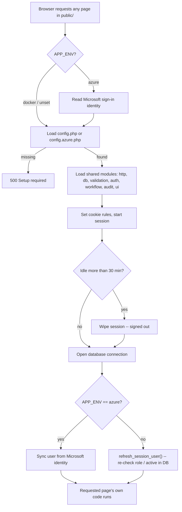
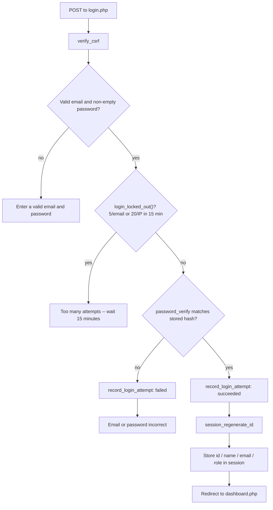
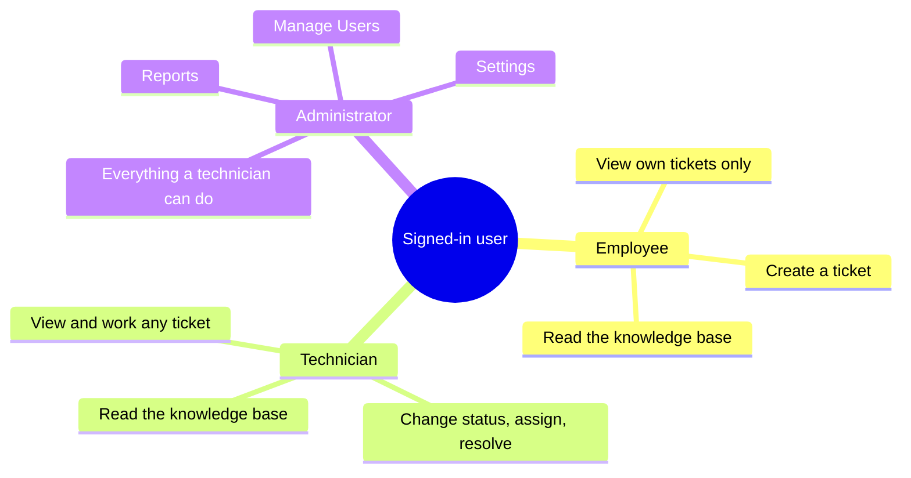

# ResolveIT – Tasks 5 & 6 (Jordan Black)

**Task 5 – Set up the application** and **Task 6 – Login and user access**

> Open this file with **Ctrl+Shift+V** in VS Code for the formatted preview. Every link jumps to the code (and line) it describes.
>
> Honesty note for the team: the first version of this system was written on Sept 8 with AI help. In late September / October it was restored, moved onto Apache, and given the security upgrades marked **(added)** below. All changes are tracked in git.

---

## Task 5 – Set up the application

**One-sentence summary:** "I set up a working shared app: the web server, PHP, the SQL Server database with its tables and an admin account, and a script that starts everything with one command."

| Piece | File | What it does |
|---|---|---|
| Start command | [start-site.ps1](../start-site.ps1) | Starts Apache at `http://127.0.0.1:8080`; does nothing if the site is already running. |
| Web server **(added)** | [deploy/apache/cts4911.conf](../deploy/apache/cts4911.conf) | Apache 2.4 + PHP 8.3. Serves only the `public/` folder so code and settings can't be downloaded, hides error details from visitors, adds security headers. |
| Database settings | [app/config.php](../app/config.php) | Points to SQL Server `WORKSTATION\JLB282`, database `TicketManagement`, Windows Authentication (no password in the code). |
| Database connection | [app/db.php](../app/db.php#L4) | Opens the connection with PDO and real prepared statements (blocks SQL injection). |
| Database tables | [database/schema.sql](../database/schema.sql) | 12 tables, 14 foreign keys: users, roles, organizations, tickets, statuses, priorities, notes, history, audit log, sign-in attempts, knowledge base. |
| Database upgrades **(added)** | [database/migrations/](../database/migrations/) | `001`–`006`: each feature's database change, safe to run twice. |
| First admin account | [scripts/create_user.php](../scripts/create_user.php) | Creates the first administrator from the command line; after that the admin creates everyone in **Manage Users**. |
| Shared startup code | [app/bootstrap.php](../app/bootstrap.php) | Every page loads this first: settings, database, session, and security helpers. |
| Team access **(added)** | [deploy/tunnel/start-tunnel.ps1](../deploy/tunnel/start-tunnel.ps1) | Gives teammates a public https link to the site running on this PC. |
| Proof it works **(added)** | [tests/check-local.ps1](../tests/check-local.ps1) | 137 automated checks (also evidence for James's Task 10). |

**Also done:** reinstalled PHP after it was deleted from the PC, moved the site from PHP's built-in test server onto real Apache, and put the project in git so every change is tracked.

**How to start it:**
```powershell
powershell -ExecutionPolicy Bypass -File start-site.ps1
```

---

## Task 6 – Login and user access

**One-sentence summary:** "Login and logout work, passwords are never stored in readable form, and every page checks who you are and what your role allows — the server blocks anything outside your role even if you type the address directly."

### Signing in, step by step

1. **The form** – [public/login.php](../public/login.php) takes email and password. A hidden form token stops fake submissions from other websites (CSRF protection) – see `csrf_token()` in [app/bootstrap.php](../app/bootstrap.php#L65) and `verify_csrf()` at [line 73](../app/bootstrap.php#L73).
2. **Lockout check (added)** – `login_locked_out()` in [app/auth.php](../app/auth.php#L25): 5 wrong passwords lock that account for 15 minutes; 20 failures from one address are also blocked. Stops password guessing.
3. **Password check** – `login_user()` in [app/auth.php](../app/auth.php#L46). Passwords are stored only as one-way hashes (`password_hash`) and checked with `password_verify` ([line 55](../app/auth.php#L55)). The error never says whether the email or the password was wrong.
4. **Fresh session ID** – [line 58](../app/auth.php#L58) replaces the session ID after login, so a stolen pre-login session is useless.
5. **Attempts recorded (added)** – `record_login_attempt()` ([line 40](../app/auth.php#L40)) saves every try in the `login_attempts` table.

### Signing out

- [public/logout.php](../public/logout.php) wipes the session completely.
- Idle for 30 minutes → signed out automatically ([app/bootstrap.php](../app/bootstrap.php#L38)).

### Role permissions (employee / technician / administrator)

| Function | Where | What it protects |
|---|---|---|
| `require_login()` | [app/auth.php](../app/auth.php#L93) | Every page: not signed in → sent to the login page. |
| `has_role()` | [app/auth.php](../app/auth.php#L101) | Shows or hides menu items, e.g. only admins see Manage Users / Reports / Settings. |
| `require_role()` | [app/auth.php](../app/auth.php#L107) | Admin pages such as [public/users.php](../public/users.php#L3) – anyone else gets **403 Forbidden**. |
| `can_view_ticket()` | [app/auth.php](../app/auth.php#L116) | Employees can open only their **own** tickets. |
| `refresh_session_user()` **(added)** | [app/auth.php](../app/auth.php#L73) | Re-checks the account on every click: deactivation, role change, or password reset by an admin takes effect immediately. |

---

## Pseudocode

Both tasks run on **every single page load** — there's no separate "login step" that only
happens once. Task 5's bootstrap runs first on every request; Task 6's access checks run
inside it, and again at the top of every protected page.

### Task 5 — what `app/bootstrap.php` does on every request

```
on every request:
    if APP_ENV == "azure":
        identity = read Microsoft sign-in identity from the platform
    else:
        identity = null

    config_file = (APP_ENV is "azure" or "docker") ? config.azure.php : config.php
    if config_file does not exist:
        stop with HTTP 500 "Setup required: copy app/config.example.php to app/config.php"
    config = load(config_file)

    load shared modules: http, db, validation, auth, workflow, audit, reports, tickets, ui

    set session cookie rules: HttpOnly, SameSite=Lax, Secure-if-request-was-HTTPS
    start session

    idle_seconds = now - session.last_activity
    if idle_seconds > config.session.idle_timeout:   // 30 minutes
        wipe session, start a fresh empty one         // = signed out
    session.last_activity = now

    pdo = open database connection
        (PDO, real prepared statements, exceptions instead of silent failures)

    if identity != null:                // Azure path
        sign in / sync user from Microsoft identity
    else:                                 // local PC / Docker path
        refresh_session_user(pdo)         // Task 6 -- re-check this user is still valid
```

### Task 5 — first admin account (`scripts/create_user.php`, command line only)

```
operator runs:  php create_user.php <email> <password> <role> "<name>"

if not running from the command line:
    refuse ("Command line only.")          // never reachable over the web
if argument count is wrong:
    print usage, stop
validate: email looks like an email, password is 12+ characters,
          role is one of employee / technician / administrator
require app/config.php to already exist
open the database connection
INSERT INTO users (role, name, email, password_hash)
    VALUES (role lookup, name, lowercase(email), password_hash(password))
```

### Task 6 — signing in (`public/login.php` + `app/auth.php`)

```
on POST /login.php:
    verify_csrf(token)                          // reject forged cross-site submits
    ip = client_ip()

    if email is not a valid address, or password is blank:
        show "Enter a valid email and password."

    else if login_locked_out(email, ip):
        // 5 bad passwords for this email, OR 20 bad attempts from this address, within 15 min
        show "Too many failed sign-in attempts. Wait 15 minutes and try again."

    else:
        user = SELECT id, name, email, password_hash, role
               FROM users JOIN roles WHERE email = ? AND active = 1
        if user is missing OR password_verify(password, user.password_hash) fails:
            record_login_attempt(email, ip, succeeded = false)
            show "The email or password is incorrect, or the account is inactive."
            // same message either way -- doesn't tell an attacker which part was wrong
        else:
            record_login_attempt(email, ip, succeeded = true)
            session_regenerate_id()              // defeats session fixation
            session.user = { id, name, email, role }
            session.login_at = now
            redirect to dashboard.php
```

### Task 6 — the access-control gate every protected page calls first

```
require_role(...allowedRoles):
    require_login()
        if nobody is signed in:
            flash "Please sign in to continue."
            redirect to login.php
    if session.user.role not in allowedRoles:
        respond 403 Forbidden, stop
    // this is the FIRST line of users.php, settings.php, reports.php --
    // the check can't be forgotten on one page because it's not optional

can_view_ticket(ticket):
    employee          -> only if ticket.requester_id == session.user.id
    technician/admin  -> always true
```

### Task 6 — keeping a live session honest (`refresh_session_user()`)

```
on every request, for a session that already has a signed-in user:
    row = SELECT name, email, active, password_changed_at, role
          FROM users JOIN roles WHERE id = session.user.id
    if row is missing, OR row.active is false,
       OR row.password_changed_at is newer than this session's login_at:
        wipe session, regenerate session id
        flash "You have been signed out because your account was changed."
    else:
        session.user = fresh { name, email, role } read from row
    // an admin deactivating someone, or changing their role or password,
    // takes effect on that user's VERY NEXT click -- not at their next login
```

---

## Process diagrams

> Mermaid diagrams — render automatically on GitHub, and in VS Code with the free
> "Markdown Preview Mermaid Support" extension. Read as plain text either way; the
> pseudocode above says the same thing in words.

### Every request (Task 5's bootstrap, with Task 6's checks running inside it)



### Signing in (`login.php`)



### Role access (mind map)



---

## 2-minute demo for the team

> A longer, timed walkthrough covering both tasks, with fallback notes for if something
> doesn't cooperate live, is in [DEMO-SCRIPT.md](DEMO-SCRIPT.md).

1. Sign in as **admin** → the sidebar shows Manage Users, Reports, Settings.
2. Sign in as an **employee** (second browser) → those items are gone; type `/users.php` in the address bar → **403 Forbidden**.
3. Enter a wrong password 5 times → "Too many failed sign-in attempts."
4. In SSMS run `SELECT email, password_hash FROM users;` → passwords are scrambled hashes, not readable text.

---

## Note for Task 4 (design choices)

The team task list says **MySQL** and **Bootstrap**. The project actually uses **Microsoft SQL Server** and a **custom stylesheet** (no outside frameworks). The design-choices section and final document should describe what was really built.
